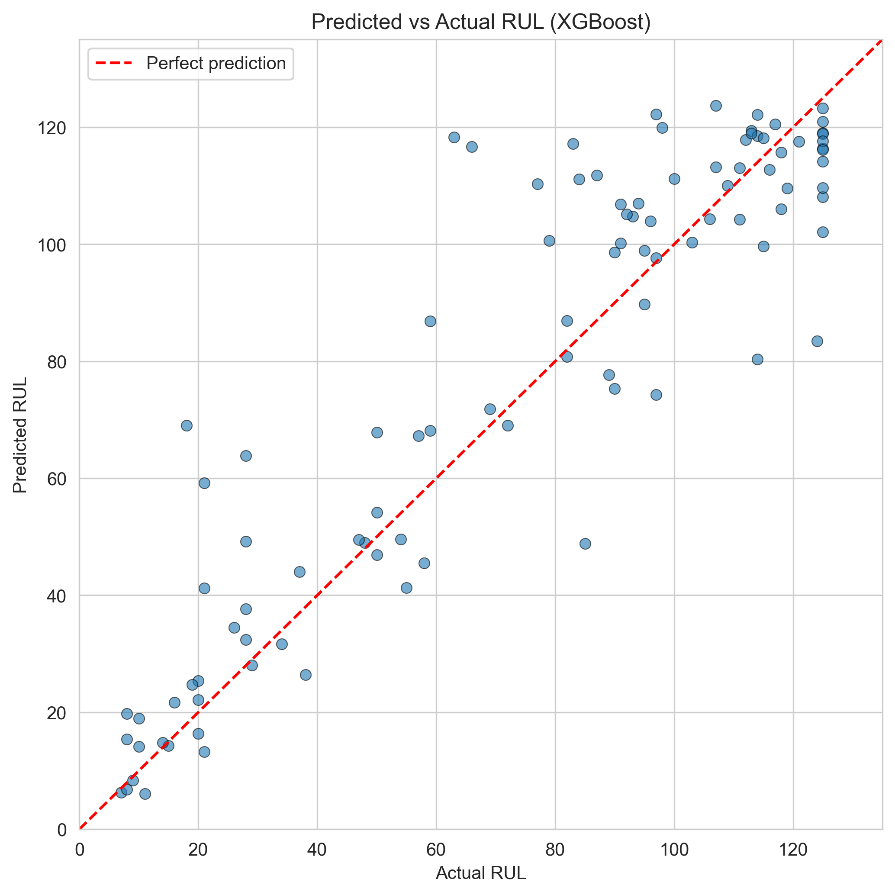
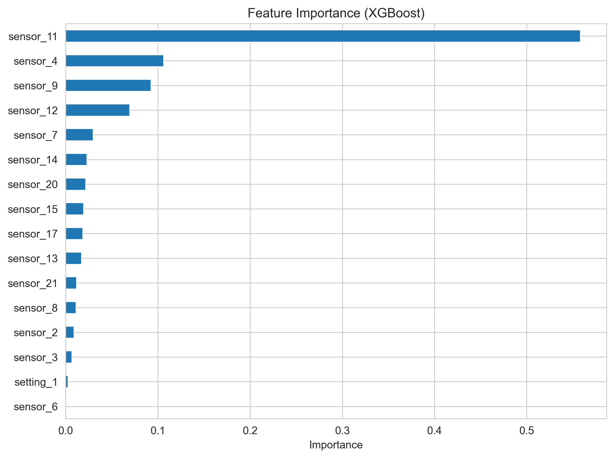

# Predictive Maintenance - Turbofan Engine RUL Prediction

## Overview
Machine learning project for predicting the **Remaining Useful Life (RUL)** of turbofan engines using the NASA C-MAPSS dataset. Three regression models are compared, with XGBoost achieving the best performance.

## Dataset
- **Source**: [NASA Prognostics Center - C-MAPSS](https://data.nasa.gov/Aerospace/CMAPSS-Jet-Engine-Simulated-Data/ff5v-kuh6)
- **FD001**: 100 engines, 20,631 samples, 21 sensors, single operating condition, single fault mode (HPC degradation)

## Results (FD001)

**Evaluation protocol**: Each model predicts RUL at the last observed cycle of each test engine (100 engines), compared against ground truth from `RUL_FD001.txt`. RUL is clipped at 125 for both training labels and test ground truth. Models are retrained on the full training set (20,631 samples, 100 engines) for test-set evaluation.

### Test Set

| Model | RMSE | MAE | R² |
|---|---|---|---|
| Linear Regression | 20.82 | 16.57 | 0.730 |
| Random Forest | 16.99 | 11.97 | 0.820 |
| **XGBoost** | **16.81** | **11.84** | **0.824** |

XGBoost achieves a **19.3% RMSE reduction** over the Linear Regression baseline.

### Validation Set (grouped by engine unit, no data leakage)

| Model | RMSE | MAE | R² |
|---|---|---|---|
| Linear Regression | 20.41 | 16.48 | 0.761 |
| Random Forest | 17.22 | 12.55 | 0.830 |
| XGBoost | 16.94 | 12.19 | 0.835 |

*80/20 split by engine unit via `GroupShuffleSplit` to prevent same-engine data from appearing in both train and validation sets.*

### Key Figures

<p align="center">
  
  
</p>

## Project Structure
```
├── CMaps/                  # Raw C-MAPSS dataset (not tracked)
├── notebooks/
│   ├── 01_RUL_Prediction_FD001.ipynb   # Full analysis pipeline
│   └── 02_Generate_Report.ipynb        # Generate figures for report
├── results/
│   ├── figures/            # High-res figures (300 DPI)
│   ├── report.tex          # LaTeX technical report source
│   └── report.pdf          # Compiled 6-page report
├── evaluate_all_models_testset.py  # Evaluate all models on test set & generate figures
├── requirements.txt
└── README.md
```

## Setup
```bash
pip install -r requirements.txt
```

## Technical Report
A 6-page LaTeX report is available at [`results/report.pdf`](results/report.pdf), covering data description, methodology, and full results analysis.

To recompile:
```bash
cd results && tectonic report.tex
```
